# Sign Collection Manager

한국수어 자료의 검색, 수집, 좌표 후처리와 검수 이력을 관리하는 로컬 애플리케이션.

산업안전·공공·의료 문서의 용어를 수어 자료에 연결할 때 발생하는 동음이의어 혼동, 중복 수집, 처리 단계별 파일 분산을 줄인다. 단어와 의미를 기준으로 원문·영상·좌표·검수 기록을 연결한다.

**Python 3.11 · Streamlit · SQLite · Pandas · NumPy · OpenAI Responses API**

## 기능

| 영역 | 구현 |
|---|---|
| 문서 입력 | 단어 일괄 입력, CSV/XLSX/TXT/PDF, LLM 핵심어·문맥상 의미 추출, 후보 선택 등록 |
| 검색 | AI Hub 메타데이터 파서, 문장·글로스·실제 시간 구간 조회, 공식 사전 검색 연결 |
| 자료 관리 | 단어+의미 식별, 주제별 분류, 영상 SHA256 중복 검사, 처리·전달 상태 기록 |
| 대체 표현 | 문맥 기반 후보 최대 3개, 구성 단어 확보 현황, 탐색 깊이·횟수 제한, 검수 기록 |
| 좌표 처리 | 전처리 파이프라인 연결, 양손 선형보간, 누락·겹침 후보와 비교 영상 확인 |
| 내보내기 | 3D 우선·2D 대체 다운로드, AI Hub 계열 좌표·재생상태 묶음, CSV/XLSX 현황 |

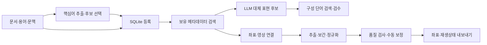

## LLM 활용

OpenAI Responses API를 문서 핵심어 추출과 대체 표현 후보 추천에 사용한다. LLM은 수집할 표현을 제안하고, 원문 대조·보유 자료 검색·사람의 검수로 연결한다. 좌표 추출·보간·정규화는 별도 전처리 코드가 담당한다.

| 기능 | 입력 | 반환 결과 | 후속 처리 |
|---|---|---|---|
| 문서 핵심어 추출 | 문서 텍스트와 출처 | 핵심어, 문맥상 의미, 원문 발췌 | 원문 대조 후 사용자가 선택한 후보만 등록 |
| 대체 표현 추천 | 단어·의미, 원문 문맥, 의미 일치를 확인한 보유 자료 목록 | 최대 3개 후보, 추천 이유, 의미 차이·위험, 구성 단어 | 구성 단어 검색, 자료 확보 여부 확인, 검수 기록 |

### 문서 핵심어 추출

**단어 검색 → 문서·단어 파일 가져오기**에서 파일을 선택하고 **문서 핵심어 AI 추출**을 켠다. PDF는 페이지별로 텍스트를 읽어 짧은 구간으로 나누며, 정해진 JSON 구조로 응답을 받는다. 원문과의 대조에서는 공백·줄바꿈 차이만 허용하고, 표시하는 발췌문은 원문에서 직접 가져온다. 원문에서 확인되지 않는 후보는 제외한다.

완료한 구간은 로컬에 보관해 재실행 시 재사용하며, 미완료 구간과 제외 안내를 구분한다. 아래는 3페이지에서 후보 28개를 표시한 실행 예시다. 이 수치는 추출 정확도나 전체 핵심어 수를 뜻하지 않는다. `sense`는 AI가 해석한 의미이므로 확인 후 등록한다.

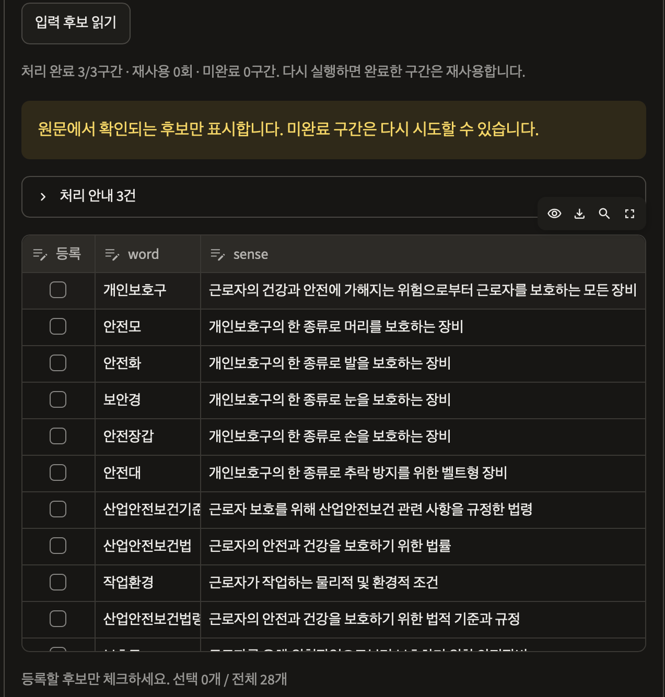

### 문맥 기반 대체 표현 추천

**대체 표현**에서 단어의 의미와 원문 문맥을 입력하고 추천을 실행한다. 예시의 ‘설비개선’에는 ‘설비 성능 향상’ 등의 후보가 제안되며, 원래 의미와 달라질 수 있는 점을 함께 표시한다. 화면의 추천 이유와 판단 근거도 AI의 설명이며 검증된 수어 표현을 의미하지 않는다.

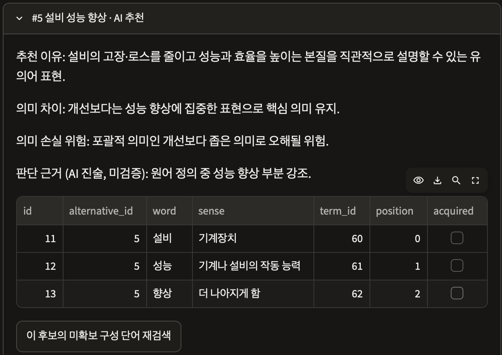

<details>
<summary>추천 설정과 후보 저장 화면</summary>

원문 문맥·보유 자료 목록의 전송에 동의한 뒤 실행한다. 추천 직후 미확보 구성 단어를 검색하는 옵션과 검색 횟수·탐색 깊이 설정을 제공한다.

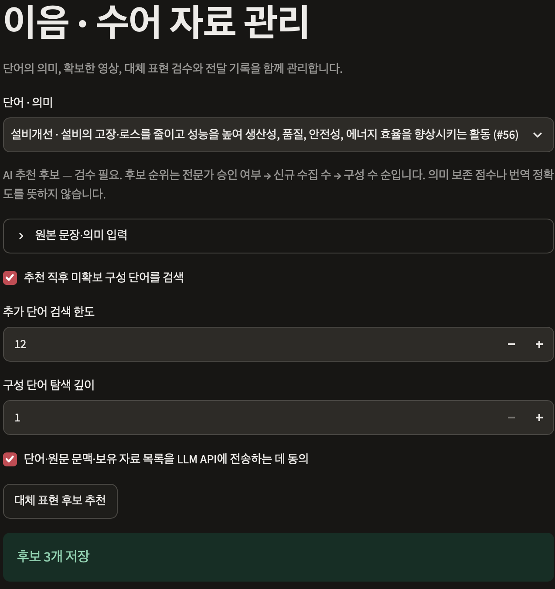

</details>

구성 단어 표의 `acquired`는 **해당 의미와 일치한다고 확인된 영상 파일의 확보 여부**다. 등록 번호나 추천 후보가 있다는 이유만으로 좌표 파일이 확보된 것은 아니다. 실제 좌표 JSON은 **단어 검색**에서 해당 구간의 파일이 발견됐을 때 내려받는다. 후보의 정렬은 검수 상태·추가 수집 필요 단어 수·구성 단어 수에 따른 프로그램 로직이며 번역 정확도 점수가 아니다.

구현: [API 요청·응답 처리](ksl_manager/llm.py), [문서 구간 처리·재사용](ksl_manager/document_batch.py), [원문 대조](ksl_manager/documents.py), [대체 표현·구성 단어 검색](ksl_manager/alternatives.py).

## 화면과 사용 흐름

화면 예시의 인물과 데이터셋 원문·식별자는 블러 처리했다.

### 수집 현황

단어·의미별로 영상 확보, 미수집, 검수 대기, 좌표 처리 현황을 확인한다. 아래 수치는 화면 촬영 당시의 작업 현황이다.

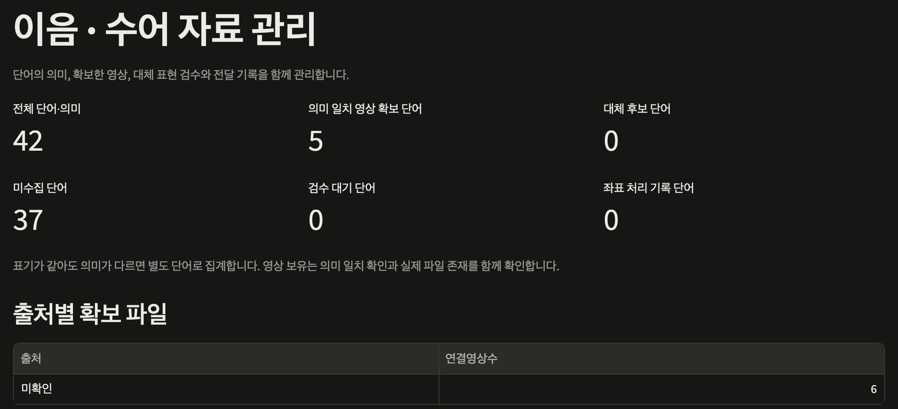

### 단어 등록과 자료 검색

단어에 문맥상 의미, 원본 문장, 문서 출처와 주제를 연결한다. 같은 표기의 단어도 의미별로 구분해 산업안전·공공·의료 자료를 관리한다.

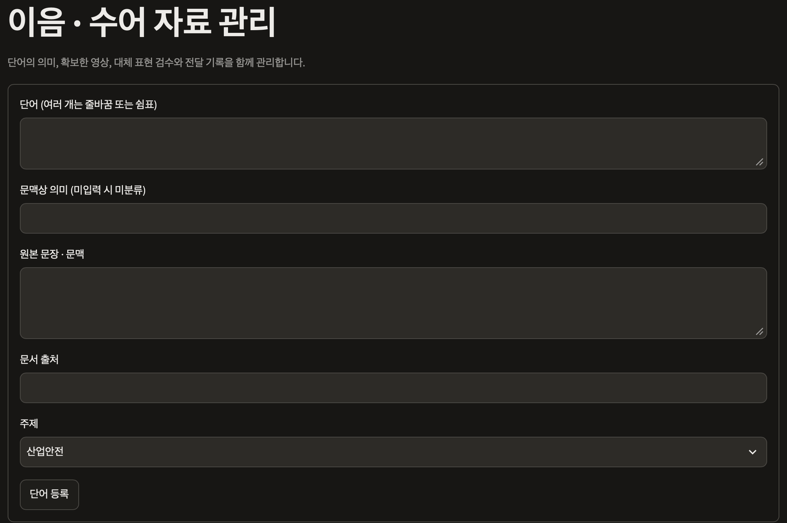

보유 메타데이터에서 글로스, 원문, 시작·끝 시간을 조회한다. 원하는 행을 선택하면 해당 구간의 좌표 JSON을 찾으며, 3D 좌표를 우선하고 없으면 2D 여부를 표시한다. 검색 후보의 문맥과 동작은 별도로 확인한다.

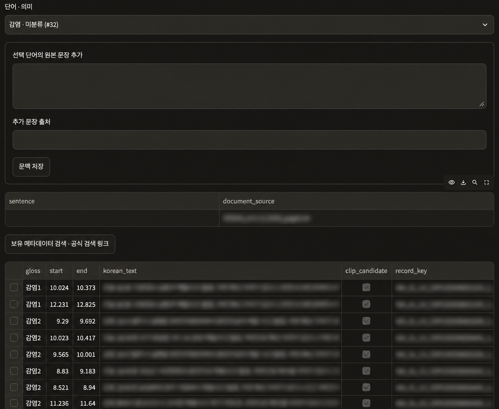

보유 자료로 확보하지 못한 단어는 한국수어사전·한국수어누리사전·AI Hub·국립국어원 말뭉치 등의 검색 화면으로 연결한다. 검색 링크와 실제 자료 확보 상태를 구분한다.

<details>
<summary>외부 자료 검색 화면</summary>

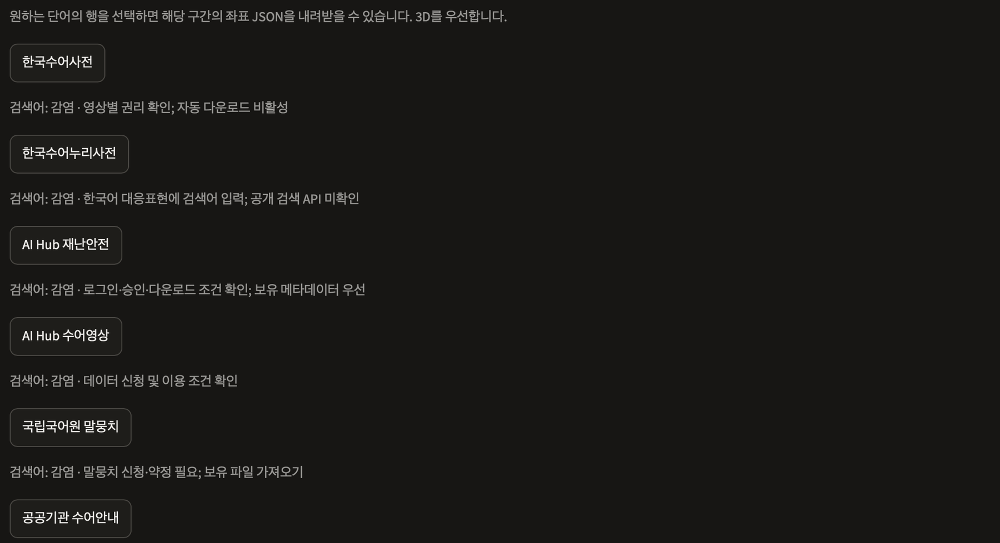

</details>

### 좌표 추출과 자동 후처리

외부 전처리 프로젝트의 경로와 Python 환경을 지정해 등록 영상을 처리한다. 양손 선형보간은 앞뒤에 유효한 좌표가 있는 짧은 내부 누락에 적용하며, 시작·끝 누락과 한도를 넘는 구간은 남긴다.

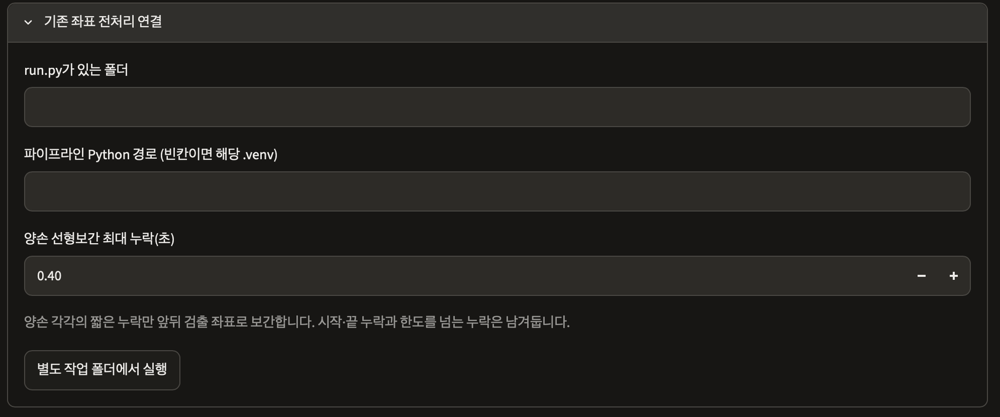

### 품질 검사와 검수

비교 영상과 시간·프레임별 확인 목록을 함께 제공한다. 남은 손 좌표 누락, 양손 겹침 후보, 원본 손 라벨 중복 등을 확인해 검수할 구간을 좁힌다. 이 목록은 자동 검출 후보이며, 실제 손 접촉이나 가림도 포함할 수 있다. 누락 프레임 수는 좌표 정확도와 구분한다.

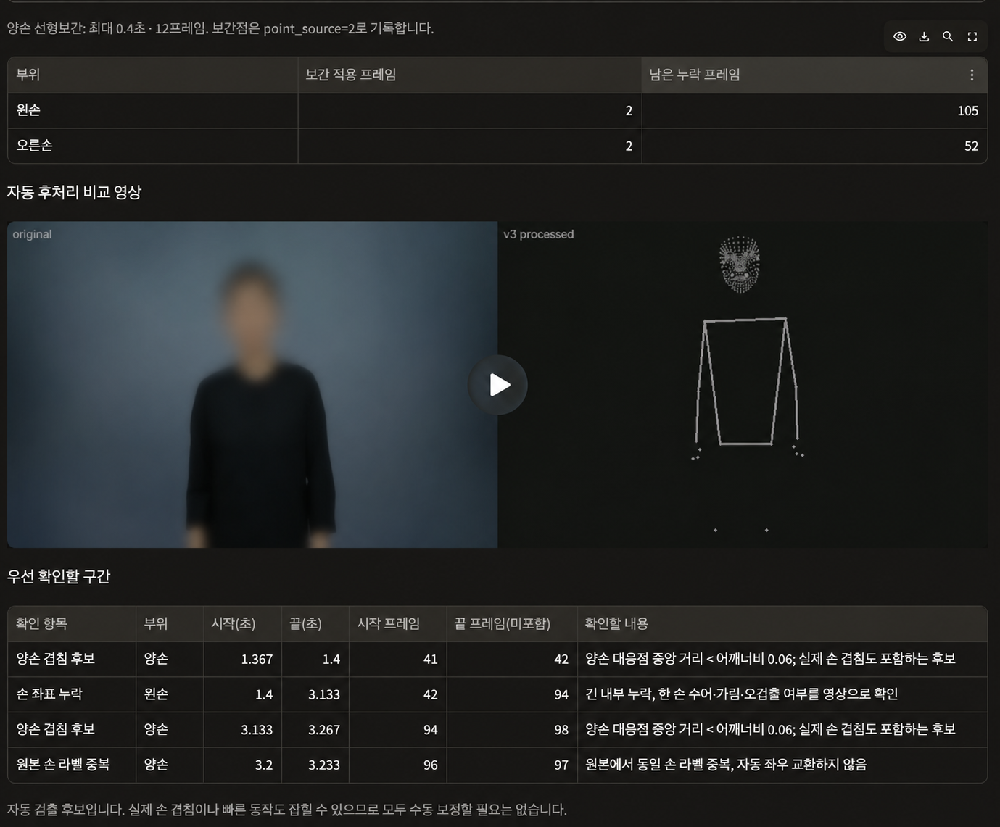

### 필요한 구간만 수동 보정

자동 후처리 후에도 오류가 남으면 영상·좌표 ZIP을 내려받아 별도 3D 보정 도구에서 확인한다. 원영상과 3D 좌표를 프레임별로 비교하고, 손 세트의 좌우 구분이나 같은 손의 중복 검출을 수정한다. 좌우 손은 영상 속 인물 기준이며, 소속 변경·중복 제외 작업은 기존 XYZ와 관련 상태를 한 세트로 다룬다.

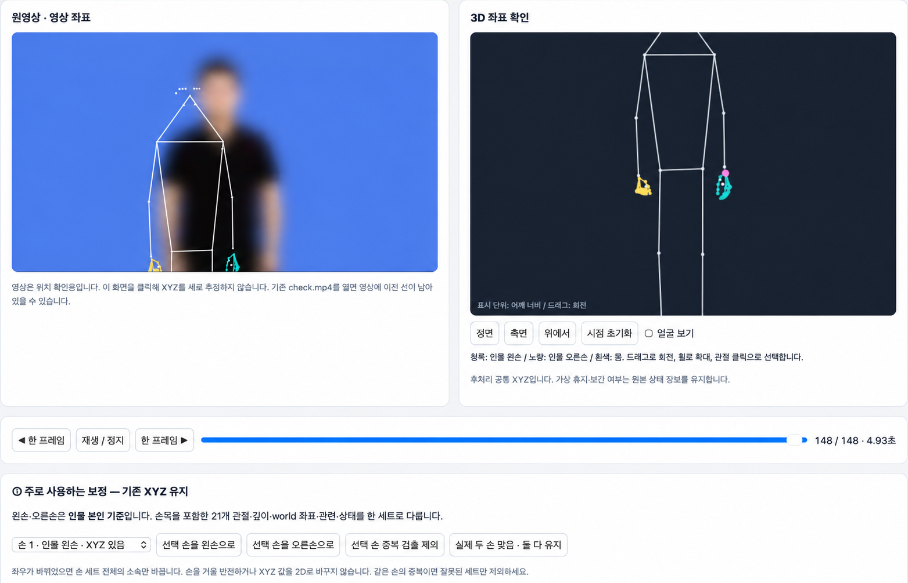

보정 결과는 좌표계와 관절 구조를 확인한 뒤 AI Hub 계열 좌표·재생상태로 내보내고, 실제 아바타 재생은 구현 단계에서 확인한다.

## 설치와 실행

Python 3.11 환경을 사용한다. 아래 명령은 이 폴더에서 실행한다.

### macOS / Linux

```bash
python3.11 -m venv .venv
source .venv/bin/activate
python -m pip install -r requirements.txt
python run.py
```

### Windows PowerShell

```powershell
py -3.11 -m venv .venv
.\.venv\Scripts\python.exe -m pip install -r requirements.txt
.\.venv\Scripts\python.exe run.py
```

접속 주소: **http://127.0.0.1:8502**

다시 실행할 때는 `python run.py`를 사용한다. macOS의 `실행.command`, Windows의 `실행.bat`, VS Code 실행 설정도 제공한다. 서버 종료는 실행 터미널에서 `Ctrl+C`.

환경 확인과 포트 변경:

```bash
python run.py --check
python run.py --port 8503
```

관리 화면과 외부 전처리 환경은 분리되어 있다. 기본 관리 기능에는 MediaPipe가 필요하지 않다. 전처리 연결은 `run.py`, `src/pipeline.py`, `config.json`이 있는 전처리 프로젝트와 해당 Python 환경을 지정한다. 기존 전처리 프로젝트는 `fcntl`을 사용하므로 macOS/Linux에서 실행한다. Windows 관리 화면은 설치 경로를 제공하지만 실제 실행 검증은 macOS에서 수행했다.

### 전처리 도구 연결

연동 대상은 같은 저장소의 [수어 좌표 전처리 파이프라인](../sign_preprocessing/README.md)이다. 먼저 해당 도구의 설치를 완료한 뒤 **데이터 관리 → 기존 좌표 전처리 연결**에서 `scripts/sign_preprocessing` 폴더를 지정한다. Python 경로를 비워 두면 해당 폴더의 `.venv`를 사용한다.

수집관리 앱은 Python 3.11, 전처리 도구는 Python 3.12 환경을 각각 사용한다. 등록한 영상의 작업 결과는 **통계·작업**에서 확인한다.

## 데이터와 설정

첫 실행 시 `data/signs.sqlite3`가 생성된다. 원영상·좌표·개인 DB는 저장소에 포함하지 않는다.

1. **메타데이터**에서 보유 JSON/JSONL/CSV/XLSX/TXT를 색인한다.
2. **단어 검색**에서 원문과 의미를 등록하고 후보 자료를 확인한다.
3. 검색 결과 행을 선택해 실제 구간 좌표를 찾는다. 검색 폴더는 화면 또는 `KSL_SOURCE_ROOTS`로 지정한다.
4. **데이터 관리**에서 영상을 등록하고 전처리를 실행한다.
5. **통계·작업**에서 비교 영상·검수 구간을 확인하고 결과를 내려받는다.

`samples/metadata_fixture.json`은 파서 확인용 합성 자료다. 수어 번역 정답이나 실제 영상으로 사용하지 않는다.

`.env.example`을 `.env`로 복사해 필요한 설정만 입력한다.

| 환경변수 | 용도 |
|---|---|
| `OPENAI_API_KEY`, `OPENAI_MODEL` | 핵심어 추출·대체 표현 추천 |
| `KSL_SOURCE_ROOTS` | 좌표 검색 폴더의 JSON 배열. 예: `["C:/datasets/signs"]` |
| `KSL_DATA_DIR`, `KSL_DB` | 개인 데이터·DB 위치 |
| `LLM_INPUT_USD_PER_MILLION`, `LLM_OUTPUT_USD_PER_MILLION` | API 사용량의 비용 환산 단가 |

API 키 없이 등록·검색·검수·내보내기를 사용할 수 있다. LLM 기능은 화면의 전송 동의 후 실행하며 호출 수·토큰 사용량을 기록한다. 단가나 사용량이 없으면 비용을 미확인으로 남긴다. [API 가격표](https://developers.openai.com/api/docs/pricing)

### LLM API 설정

각 사용자는 자신의 컴퓨터에서 `.env.example`을 `.env`로 복사하고 **본인의 OpenAI API 키**를 설정한다. 저장소에는 실제 키를 포함하지 않는다. GitHub에서 코드를 받는 것만으로 작성자의 API 키나 크레딧이 연결되지는 않는다.

```dotenv
OPENAI_API_KEY=your_api_key_here
OPENAI_MODEL=gpt-4.1-mini
```

`OPENAI_MODEL`에는 해당 API 계정에서 사용할 수 있는 모델을 지정한다. 설정을 바꾼 후 실행 중인 앱을 종료하고 다시 실행한다. API 사용 비용은 입력한 키에 연결된 조직·프로젝트에 청구된다. ChatGPT 구독과 API 결제는 별도다. [API 결제 안내](https://help.openai.com/en/articles/9039756-managing-billing-for-chatgpt-and-the-api-platform)

- **키 없이 사용:** 단어 등록, 보유 메타데이터 검색, 자료·검수 기록 관리와 내보내기. 문서 후보는 등록어·초기 단어의 문자 대조 방식으로 제공한다.
- **키가 필요한 기능:** 문서 핵심어 AI 추출, 대체 표현 후보 추천.
- **비용 관리:** 먼저 1~3페이지 발췌본으로 실행하고, 이미 처리한 구간은 재사용한다. 앱의 토큰 기록·비용 환산은 참고용이며 실제 청구 내역은 API Usage에서 확인한다. 토큰 출력 한도와 검색 횟수 설정은 금액 상한이 아니다.

실제 키가 들어 있는 `.env`는 GitHub나 메신저로 공유하지 않는다. 공용 API를 운영하려면 별도 서버에서 키와 사용자별 사용량을 관리해야 하며, 이 로컬 앱에는 공용 키 배포 기능이 없다.

## 처리 기준

- 같은 표기라도 의미가 다르면 별도 항목으로 관리한다.
- 검색 결과, 영상 확보, 검수·전달 완료를 구분한다.
- 출처·이용조건은 공통 설정을 재사용하며 빈 값은 미확인으로 기록한다.
- 단어별 시간 구간이 확인된 경우에만 해당 좌표를 내보낸다. 3D가 없으면 2D를 별도 표시하고 깊이를 만들어내지 않는다.
- 양손 선형보간은 기본 0.4초 이내의 내부 누락에 적용한다. 원래 좌표와 시작·끝·긴 누락은 유지하고 보간점의 출처를 기록한다.
- `avatar.json`은 보정 입력이다. AI Hub 계열 좌표는 같은 프레임의 재생상태와 함께 사용한다.
- LLM 후보와 자동 검수 경고는 확정 번역·오류 판정이 아니다. 검수와 실제 아바타 재생 확인을 별도로 수행한다.

## 구조

```text
app.py                  Streamlit 화면
run.py                  실행 진입점
ksl_manager/            DB·검색·추천·후처리 연결·내보내기
    schema.sql          관계형 스키마
samples/                합성 입력 예시
tests/                  기능·UI 검사
tools/                  후처리기·좌표 로더
docs/                   설계·검증·자료 출처
```

[설계와 ERD](docs/architecture.md) · [검증 결과](docs/validation.md) · [자료 출처](docs/sources.md)

## 검증

```bash
python -m pip install -r requirements-dev.txt
python -m unittest discover -s tests -v
ruff check .
ruff format --check .
```

주요 검사: 의미별 중복·외래키, 원본 시간 구간, 후보 선택 등록, 탐색 상한, 양손 보간 경계, XYZ·출처 보존, 좌표·재생상태 로더 호환, 빈 DB의 화면 동작.

실제 보유 메타데이터 15,834문장의 색인·검색 및 고열 영상의 양손 보간 결과는 [검증 문서](docs/validation.md)에 정리했다. 검색 시간·누락 프레임 수는 측정 범위를 함께 기록하며 번역 정확도로 해석하지 않는다. `requirements-lock.txt`는 검증 환경의 패키지 목록이다.

## 코드 출처와 변경 범위

좌표 후처리의 기반 코드는 **프로젝트 멘토가 제공한 `postprocess_v3.py`**다. 원본에도 결측 선형보간이 포함되어 있다.

본 프로젝트에서는 보간을 유효한 앞뒤 좌표가 있는 내부 구간으로 제한하고, 양손 보간 한도 분리, 관측 좌표 보존, 보간·수동 수정·가상 휴지 상태 기록, 재추출 없는 후처리를 결합했다. 자료 수집·검색, SQLite 관리, LLM 후보 추천, 검수 화면과 좌표·재생상태 내보내기는 별도 모듈로 구성했다.

상세 내용은 [코드 출처](docs/sources.md#코드-출처와-변경-범위)에 정리했다. 외부 제공 코드의 공개·재배포 허용 범위는 확인 후 반영한다.

## 범위

외부 사이트는 확인된 검색 화면으로 연결하며 무인 크롤링·인증 우회·일괄 영상 다운로드를 제공하지 않는다. 이미지 PDF의 OCR, 말뭉치 EAF/XML 전용 파서, 사용자 인증과 다중 사용자 운영은 포함하지 않는다. SQLite 파일은 로컬 상태 저장소이며 GitHub 업로드로 데이터가 동기화되지는 않는다.
