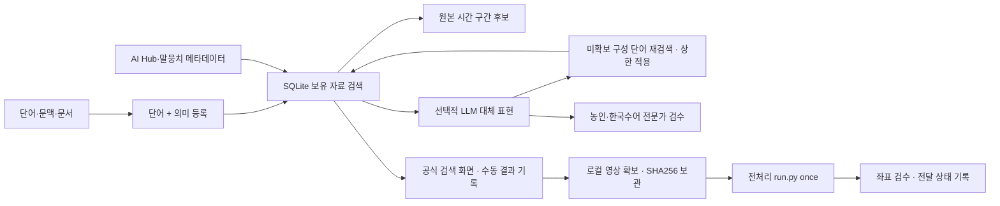
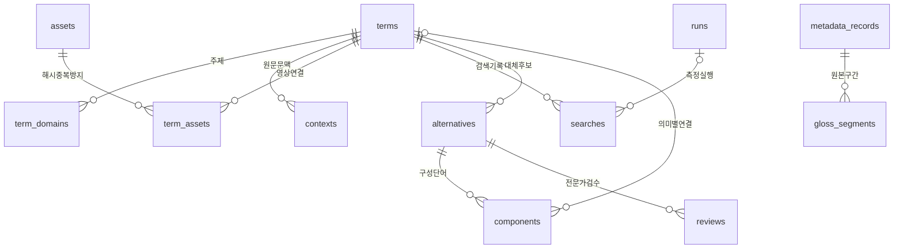

# 시스템 구조

## SQLite ERD

- `terms`: 같은 표기+같은 의미는 1행. 미분류는 문맥별로 분리. 표기만 같다고 같은 뜻으로 합치지 않는다.
- `term_domains`: 산업안전/공공기관·의료/공통을 복수 연결한다. 원본 영상은 주제마다 복제하지 않는다.
- `contexts`: 원문 문장, 문서 출처를 별도로 보관한다. PDF 입력은 페이지 번호 포함.
- `assets`: 파일 SHA256, 원본 이름, 보관 위치, 크기. `term_assets`는 의미 일치 검수와 전처리·전달 상태를 별도로 기록한다.
- `metadata_records/gloss_segments`: 데이터셋·학습 분할·원본 파일 해시·기록 ID·한국어·영상 정보·비수지 표현·실제 시간 구간. 좌표 본문을 복제하지 않는다.
- `alternatives/components/reviews`: 추천, 필요한 구성 단어, 검수자·역할·판정 근거. 전문가 승인은 역할을 직접 선언하는 로컬 관리 기능이며 신원 인증은 제공하지 않는다.
- `searches`: 검색 링크/발견/미확인/실패를 구분한다. 검색 실패는 수어 부재를 뜻하지 않는다.
- `runs/api_usage/events`: 측정 조건·실제 시간·API 응답 사용량·중복 및 재사용 이벤트. 일반적인 성공률은 등록 목록의 현재 현황이며, 번역 정확도가 아니다.

SQL 원본: `ksl_manager/schema.sql`. DB 열 추가는 `db.py`에서 기존 파일을 보존하며 적용한다.

## 모듈

| 모듈 | 역할 |
|---|---|
| app.py | Streamlit 6개 화면 |
| service.py | 의미별 등록, 해시 보관, 상태 변경, 검수 |
| metadata.py | 확장 가능한 파서 레지스트리와 검색 |
| sources.py | 공식 페이지 연결, 사용자가 확인한 결과 기록 |
| documents.py | 파일 입력·PDF 텍스트·선택적 핵심어 추출 |
| llm.py | Responses API, 토큰 사용량·오류·비용 기록 |
| alternatives.py | 최대 3개 후보, 제한된 구성 단어 재검색 |
| metrics.py | 현황 지표, 같은 조건 실험 비교, 안전한 CSV/XLSX |
| preprocessing.py | 전처리 실행, 작업별 입력·출력·로그 격리 |
| coordinate_export.py | 원본 ID·시간 검증, 3D 우선·2D 대체 구간 내보내기 |
| interpolation.py | 작업별 엔진 구성과 추출 좌표 재사용 |
| delivery.py | 좌표·재생상태 페어와 로더 묶음 생성 |
| run.py | 실행 환경 검사와 서버 시작 |

전처리는 별도 Python 환경에서 실행할 수 있다. 관리 도구의 Python 3.11에 MediaPipe를 필수 설치하지 않는다.

## 실행과 데이터 경계

`run.py`는 현재 Python 환경으로 Streamlit을 실행하고 프로젝트 위치를 작업 디렉터리로 고정한다. 검색 경로는 환경변수 또는 화면에서 입력한다. 개인 상태는 `data/`와 `.env`에 저장한다.

전처리 실행은 작업별 엔진 복사본과 설정을 사용한다. 외부 전처리 프로젝트의 `make_check_video` 분기 앞에 보간 인자를 연결하며 AST로 실행 위치를 확인한다. 프레임별 관측·보간·수동 수정·휴지 상태는 변환 후에도 보존한다.
