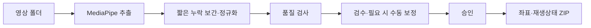

# 수어 좌표 전처리 파이프라인

**대상: macOS/Linux · Python 3.12. 실행 검증: macOS ARM64. Windows는 지원하지 않습니다.**

수어 영상의 좌표 추출·보간·정규화·품질 검사와 검수 승인 후 데이터 전달을 자동화합니다.

## 핵심 수치

- 2D 양손 PCK@0.1: **93.40% → 95.81%** (70클립·2,006프레임).
- 누락 관절 수: **3,149 → 617점** (80.41% 감소).
- 신호처리·진단·관리 기능 테스트: **40개 통과**.

평가 방법과 수동 보정 통계는 [품질 평가 보고서](../../docs/sign_preprocessing/품질평가_보고서.md)에 있습니다.

## 처리 흐름



## 실행

이 폴더에서 실행합니다.

```bash
python3 setup_local.py
.venv/bin/python run.py watch
```

관리 화면: http://127.0.0.1:8765

macOS에서는 `설치.command` → `실행.command`를 사용하거나, VS Code에서 이 폴더를 열고 F5로 실행할 수 있습니다.

1. `입력영상/`에 `단어.mp4`를 추가합니다.
2. 자동 처리 후 관리 화면에서 비교 영상과 검수 구간을 확인합니다.
3. 필요하면 추출용 영상과 후처리 좌표를 HTML 보정 도구에 넣어 수정합니다.
4. 보정 JSON을 등록·재검사하고 승인합니다. 수정이 없으면 바로 승인합니다.
5. 승인 자료 전달 ZIP을 생성합니다.

관리 화면의 비교 영상은 자동 후처리 시점입니다. 수동 보정본의 최종 움직임은 HTML에서 확인합니다.

## 설정과 결과

`config.json`에서 입력·저장 경로, 감시 간격, 보간·스무딩, 포트를 설정합니다. 기본은 30fps·최대 5프레임 보간·스무딩 OFF·가상 휴지 OFF입니다. 처리 코드를 바꾸거나 설정을 변경하면 새 `run_name`을 사용합니다.

| 경로 | 내용 |
|---|---|
| `입력영상/` | 입력 영상 |
| `작업결과/` | 원본·좌표·비교 영상·검수 기록·전달 ZIP |
| `models/` | SHA256으로 검증하는 MediaPipe 모델 캐시 |
| `src/` | 추출·후처리·검사·변환·감시 코드 |
| `tools/` | 수동 보정 도구·로더 |
| `tests/` | 신호처리·관리 기능 테스트 |

프로그램 실행 중 감시하며 Ctrl+C로 종료합니다. 크기가 8초간 안정된 파일을 처리합니다. 큰 파일은 복사 완료 후 영상 확장자로 변경할 수 있습니다.

전달 ZIP은 `좌표_3D/`, `재생상태/`, `자료목록.json`, 로더로 구성됩니다. 몸25·얼굴70·손21점 구조입니다. 보정본 등록 시 기존 승인을 취소하고 재검사합니다.

## 재현 평가

원본 영상·라벨은 저장소에 포함하지 않습니다. 적법하게 확보한 AI Hub 샘플 경로를 지정합니다.

```bash
.venv/bin/python build_evaluation_references.py \
  --label-dir /path/to/aihub-sample --output-dir /path/to/reference70
.venv/bin/python run_reference_evaluation.py \
  --reference-dir /path/to/reference70 --source-video-dir /path/to/aihub-sample \
  --output-dir /path/to/evaluation2d
.venv/bin/python evaluate_relative3d.py \
  --label-dir /path/to/aihub-sample --source-video-dir /path/to/aihub-sample \
  --output-dir /path/to/evaluation3d
```

구간 목록으로 70개 2D 라벨을 재구성하고 원본 영상에서 같은 프레임을 잘라 처리합니다. 3D는 해당 샘플 중 3D 라벨과 앞면 영상이 일치하는 4개 전체를 평가합니다. 직접 촬영 영상 데모는 제공하지 않습니다.

## 3D 결과 해석

원본 4개·2,549프레임의 어깨 정규화 비교에서 원래 예측의 평균 거리는 2.373, 같은 XY의 Z=0 기준선은 0.936이었다. Z 부호 반전은 악화됐고 배율 변경에 민감했다. 기준 라벨에도 극단값이 있어, 좌표 규약·스케일·라벨 품질을 확인하기 전에는 이 값을 확정적인 3D 복원 성능으로 해석하지 않는다.

0.1·0.2·0.5·1.0 기준을 함께 제공한다. 0.5·1.0을 추가해도 원래 수치를 지우거나 진단용 유리한 배율을 실제 성능으로 채택하지 않는다.

```bash
.venv/bin/python diagnose_relative3d.py \
  --result-dir /path/to/saved-results/3D_4영상 \
  --label-dir /path/to/aihub-sample --output-dir /path/to/depth-diagnostics
```

진단은 저장된 예측에만 적용하며 원본 좌표·배포 데이터는 바꾸지 않는다. [진단과 평가 보고서](../../docs/sign_preprocessing/품질평가_보고서.md)를 참고한다.

## 개발 검사

```bash
.venv/bin/python -m pip install -r requirements-dev.txt
.venv/bin/python -m ruff format --check .
.venv/bin/python -m unittest discover -s tests -v
```

`ruff check`는 E4·E7·E9·F·I·E501 규칙을 오류 무시 없이 검사합니다. 40개 테스트는 보간 경계·한도, 정규화 역변환, PCK 분모·경계, BODY25·손 매핑, 3D 정규화·깊이 오차·진단 기준선, 모델 해시, 감시·잠금·승인·HTTP를 확인합니다.

## 의존성

| 직접 의존성 | 사용 |
|---|---|
| numpy | 좌표 배열·보간·정규화·평가 |
| mediapipe | 몸·얼굴·손 좌표 추출 |
| opencv-contrib-python | 영상 읽기·쓰기·검수 영상 표시 |
| imageio-ffmpeg | 동영상 변환 실행 파일 |

`matplotlib`·`sounddevice`는 MediaPipe의 간접 의존성이고 `Pillow`는 matplotlib의 간접 의존성입니다. 애플리케이션의 그래프·음성 기능으로 직접 사용하지 않습니다. `requirements.txt`는 직접 의존성, `검증환경.txt`는 개발 도구를 포함한 전체 설치 기록입니다.

## 한계와 출처

- 자동 검사는 오류 후보를 제시하며 실제 손 겹침·빠른 동작도 포함할 수 있습니다. 전체 영상 검수는 별도입니다.
- 2D PCK는 위치 일치도이며 수어 의미·문법·사용자 이해도가 아닙니다. 상대3D 평가는 어깨 정규화 형상 비교이고 mm 단위 오차가 아닙니다. Z 규약·스케일·라벨 품질의 추가 검증이 필요합니다.
- 단일 촬영자 TW07·한파 안내 자료에 한정됩니다. 직접 촬영 영상의 일반화 성능은 확인하지 않았습니다.
- 자료: [AI Hub 재난 안전 수어 데이터](https://www.aihub.or.kr/aihubdata/data/view.do?dataSetSn=636), 국립국어원 수어사전 참고 영상.
- 자동 후처리: 멘토 제공 v3 기반 수정. 모델 SHA256은 공식 배포 URL에서 확보한 파일을 프로젝트에서 고정한 값이며 공식 기관이 발행한 서명을 뜻하지 않습니다.
- 선택적 LLM 검수 안내는 기본 OFF이며 좌표 변경·승인을 수행하지 않습니다.
